<div align="center">

<picture>
  <source media="(prefers-color-scheme: dark)" srcset="docs/readme/logo-dark.png">
  
</picture>

### FAQ 기반 통신 상담 챗봇

통신 FAQ를 근거로 답하고, 조건이 빠지면 되묻고, 매장과 요금제 업무까지 채팅에서 연결합니다.

[서비스 바로가기](https://www.telme.site) · [프론트엔드 저장소](https://github.com/TEL-ME/TEL-ME_FE) · [문서 모음](#문서-모음)

<br>


<br>


&nbsp;&nbsp;&nbsp;


<sub>상담 캐릭터 <b>무러바라</b></sub>

</div>

<br>

<p align="center">
<a href="#프로젝트-소개">소개</a> ·
<a href="#화면">화면</a> ·
<a href="#답변-파이프라인">파이프라인</a> ·
<a href="#핵심-설계">핵심 설계</a> ·
<a href="#측정으로-정한-결정">측정 결과</a> ·
<a href="#시스템-아키텍처--배포">아키텍처</a> ·
<a href="#기술-스택">기술 스택</a> ·
<a href="#erd">ERD</a> ·
<a href="#관리자-화면">관리자</a> ·
<a href="#api-요약">API</a> ·
<a href="#실행-방법">실행 방법</a> ·
<a href="#문서-모음">문서</a> ·
<a href="#팀--일정">팀</a>
</p>

<br>

## 프로젝트 소개

RAG 기반 AI 통신 상담과 위치 기반 매장 안내를 하나의 채팅에서 제공하는 **TEL-ME**의 백엔드 저장소입니다.

| 통신 FAQ | 답변 파이프라인 | 근거 확인 지점 |
| :---: | :---: | :---: |
| **1,150건** 생성·검증·적재<br><sub>10개 카테고리 × 유형 5 × 페르소나 3</sub> | **6단계**<br><sub>입력 검사부터 답변 검사까지</sub> | **2곳**<br><sub>검색 판정, 답변 검사에서 이중 차단</sub> |

### 세 가지 문제, 세 가지 방향

| 문제 | | 방향 |
| --- | :---: | --- |
| **일반 챗봇의 환각** — 근거 없는 금액·조건 안내를 고객이 그대로 믿고 손해 | → | **근거 우선** — 찾은 FAQ가 있을 때만 답하고, 참고한 FAQ를 함께 공개 |
| **조건마다 다른 답** — 나이, 사용량, 매장 검색 방법에 따라 안내가 달라짐 | → | **되묻기** — 조건이 빠지면 답하기 전에 먼저 확인 |
| **반복 문의, 긴 대기** — 요금, 유심, 번호이동처럼 같은 질문이 반복됨 | → | **업무 연결** — 요금제 추천 후 가입·변경 화면으로, 매장 찾기와 길찾기는 채팅에서 |

### 기본 요구 위에 더한 것

| 과제 기본 요구 | 우리 팀이 더한 기능 |
| --- | --- |
| ✅ FAQ 1,000건 이상 생성<br>✅ Vector DB 저장·검색<br>✅ 검색 FAQ 기반 LLM 답변<br>✅ 현재 위치 기준 가까운 매장<br>✅ 응답 중·재시도·완료·실패 상태<br>✅ 관리자 FAQ·매장 관리 | **되묻기** — 조건이 빠진 질문엔 답 대신 확인 질문<br>**이어 묻기** — 생략된 대상을 앞 대화와 연결<br>**복합 질문 처리** — 한 문장 속 두 질문을 나눠 각각 답변<br>**후속 질문 추천** — 답변 뒤 다음 질문 제안<br>**업무 화면 연결** — 요금제 가입·변경 화면, 매장 찾기·길찾기<br>**운영 품질 관리** — AI 처리 흐름 모니터링, 장애 시 자동 대체 |

<br>

## 화면

<table>
  <tr>
    <td align="center" width="20%">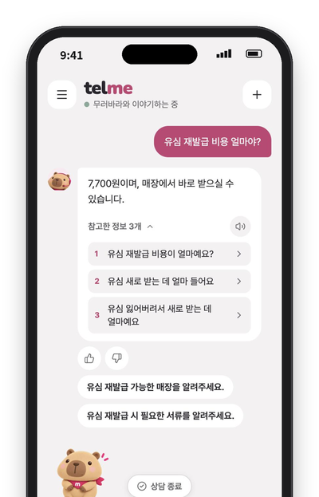</td>
    <td align="center" width="20%">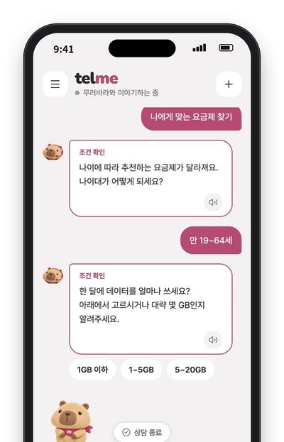</td>
    <td align="center" width="20%">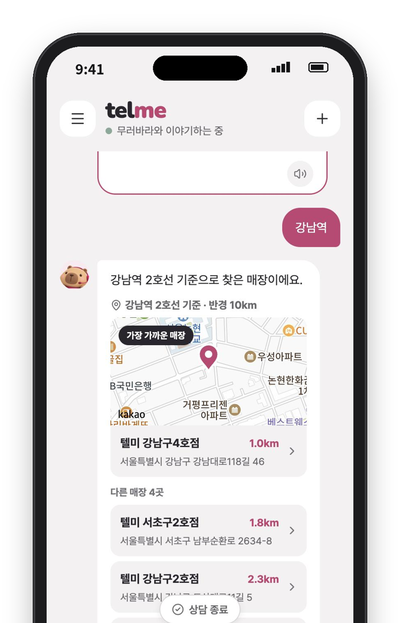</td>
    <td align="center" width="20%">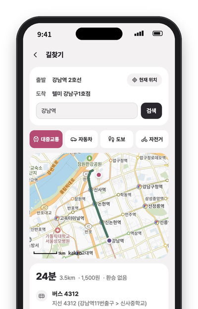</td>
    <td align="center" width="20%"></td>
  </tr>
  <tr>
    <td align="center"><b>근거와 함께 답변</b><br><sub>참고한 FAQ 3개 공개</sub></td>
    <td align="center"><b>조건 되묻기</b><br><sub>나이·사용량을 먼저 확인</sub></td>
    <td align="center"><b>매장 찾기</b><br><sub>지역·지명·현재 위치</sub></td>
    <td align="center"><b>길찾기</b><br><sub>대중교통·자동차·도보</sub></td>
    <td align="center"><b>요금제 추천</b><br><sub>가입 화면으로 연결</sub></td>
  </tr>
</table>

<br>

## 답변 파이프라인

<p align="center">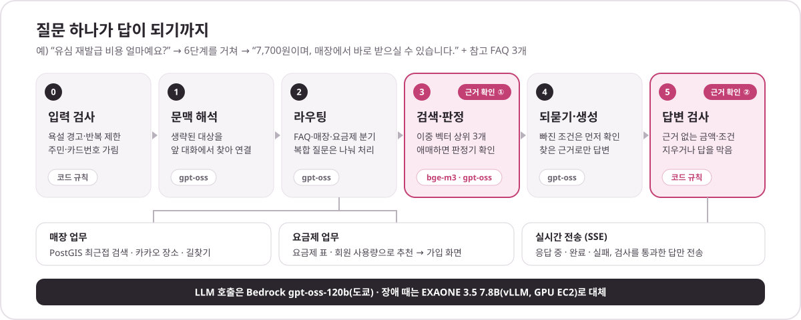</p>

| 단계 | 하는 일 | 주요 클래스 |
| --- | --- | --- |
| **0** 입력&nbsp;검사 | 욕설 경고·반복 위반 일시 제한, 주민번호·카드번호 가림 | `ChatInputGuardService` |
| **1** 문맥&nbsp;해석 | “그럼 비용은요?”처럼 생략된 대상을 앞 대화에서 찾아 질문을 완성 | `ChatQuestionResolver` |
| **2** 라우팅 | FAQ · 매장 · 둘 다 · 범위 밖으로 분류, 요금제 질문은 요금제 업무로, 복합 질문은 나눠 처리 | `QueryRoutingService`<br>`PlanQuestionClassifier` |
| **3** 검색·판정 | 이중 벡터로 상위 3개를 고르고, 점수가 애매하면 판정기가 다시 읽음 | `PgvectorFaqSearchService`<br>`FaqEvidenceJudge` |
| **4** 되묻기·생성 | 답을 가르는 조건이 빠지면 먼저 묻고, 찾은 근거로만 답변 | `ConsultChatProcessingService`<br>`RagAnswerGenerator` |
| **5** 답변&nbsp;검사 | 근거에 없는 금액·조건 문장을 지우거나 답을 막음 | `AnswerGuard` |

검사를 통과한 답만 SSE로 전송하고, 실행마다 단계별 결과·소요 시간·LLM 호출을 남겨 관리자 화면에서 그대로 볼 수 있습니다.

<br>

## 핵심 설계

### 1. 검색 · 근거 판정

<p align="center">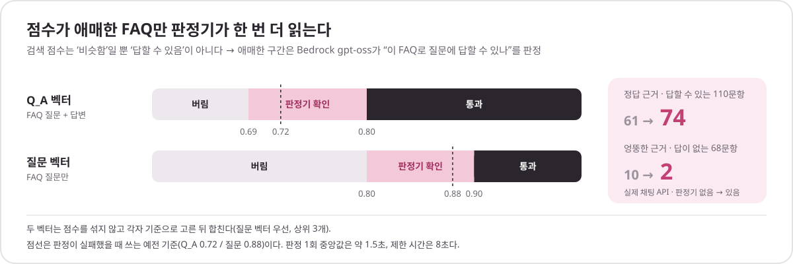</p>

- **이중 벡터**: FAQ마다 `질문+답변(Q_A)`과 `질문만` 두 벡터를 저장합니다(bge-m3). 짧은 구어체 질문은 질문 벡터가, 내용으로 묻는 질문은 Q_A 벡터가 잘 찾습니다.
- **점수는 섞지 않는다**: 두 벡터의 점수 분포가 달라 각자 기준으로 고른 뒤 질문 벡터 우선으로 합쳐 상위 3개를 씁니다.
- **리랭커 대신 판정기**: 리랭커는 정답을 조금 더 찾았지만 검색 시간이 단일 벡터의 약 6.9배였습니다(이중 벡터는 1.09배). 대신 애매한 구간만 Bedrock gpt-oss가 “이 FAQ로 답할 수 있나”를 판정합니다. → [dual-vector-vs-reranker](docs/01-pipeline/03-retrieval/dual-vector-vs-reranker.md), [gray-zone-upper-band](docs/01-pipeline/04-evidence-judgment/gray-zone-upper-band.md)

### 2. 되묻기

요금제 추천엔 나이·사용량, 매장 찾기엔 지역처럼 **답을 가르는 조건**이 빠지면 확인 질문을 먼저 보냅니다. 필요 없는 되묻기는 오히려 상담을 늘리므로, 조건 뽑기를 EXAONE에서 gpt-oss로 바꿔 실제 채팅 흐름 32건의 되묻기가 31개에서 14개로 줄었습니다. → [clarification-extraction-model](docs/01-pipeline/05-clarification/clarification-extraction-model.md)

### 3. 문맥 해석

“유심 재발급 비용 얼마예요?” 다음의 “그럼 비용은?”, “○○는요?” 같은 후속 질문은 문맥 해석 단계가 앞 대화에서 대상을 찾아 완성된 질문으로 바꿉니다. 새 요청(“명의 정정하고 싶어요”)은 앞 대화에 잇지 않습니다. → [context-resolution](docs/01-pipeline/02-context-routing/context-resolution.md)

### 4. 답변 검사

모델이 쓴 답에서 근거 FAQ에 없는 금액·수량·조건을 코드 규칙으로 찾아 지우거나 답을 막습니다. 금액 때문에 막힌 답은 추론을 늘려(reasoning medium) 한 번 다시 생성합니다 — 같은 입력에서 틀린 금액이 나온 답이 20/30에서 0/30이 됐습니다. → [chat-output-guard](docs/01-pipeline/07-answer-validation/chat-output-guard.md), [gpt-oss-switch](docs/04-operations/gpt-oss-switch.md)

### 5. 장애 대체

<p align="center">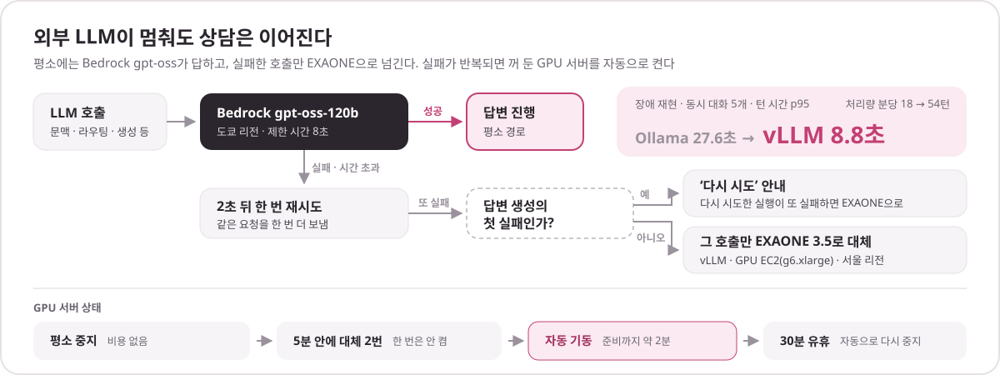</p>

GPU 서버는 평소 꺼 두고, 5분 안에 대체가 2번 나면 켜며, 30분 동안 쓰이지 않으면 다시 끕니다. 대체 서빙을 Ollama에서 vLLM으로 바꿔 장애 재현(동시 대화 5개) p95가 27.6초에서 8.8초가 됐습니다. → [serving-comparison](docs/04-operations/serving-comparison.md), [chat-failure-fallback-verification](docs/04-operations/chat-failure-fallback-verification.md)

### 6. 답변 품질 평가 (LLM Judge)

실제 채팅 API가 만든 답을 **근거성 · 질문 충족도 · 보류 판단** 세 축으로 판정합니다. Qwen3 235B, DeepSeek V3.2, Mistral Large 3가 따로 판정하고 **하나라도 실패면 실패**로 결합합니다. 범위 밖 질문, 매장 결과처럼 코드로 정해지는 판정은 모델을 부르지 않습니다. → [chat-judge](docs/03-evaluation/chat-judge/README.md)

<br>

## 측정으로 정한 결정

<p align="center">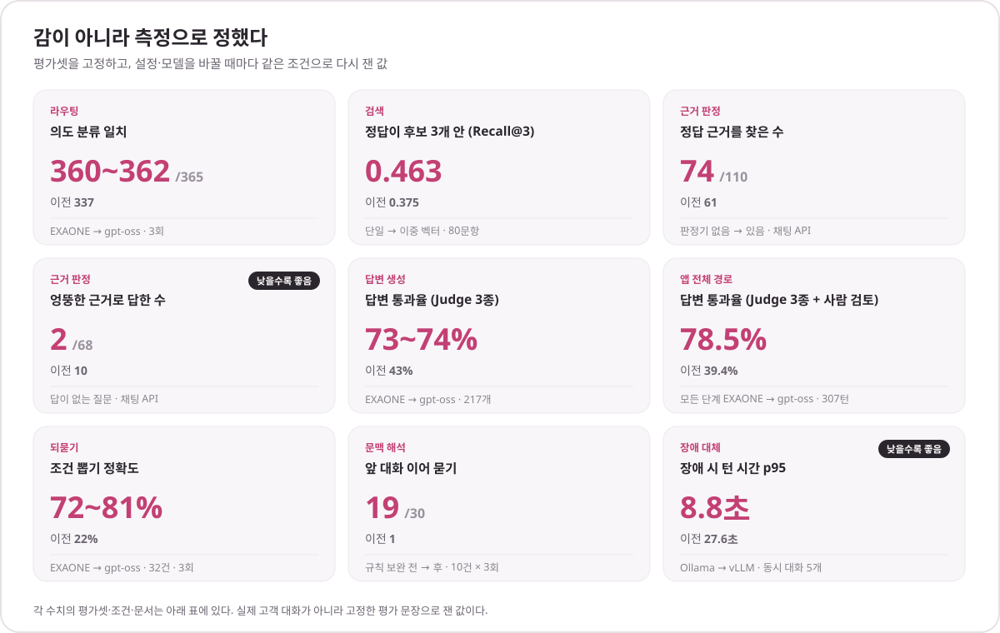</p>

| 바꾼 것 | 이전 → 이후 | 조건 · 문서 |
| --- | --- | --- |
| **라우팅** 의도 분류 EXAONE → gpt-oss | 337 → **360~362** / 365 | 라우팅 평가셋, 3회 · [문서](docs/01-pipeline/02-context-routing/routing-call-comparison.md) |
| **검색** 단일 → 이중 벡터 | Recall@3 0.375 → **0.463**<br>Recall@1 0.312 → **0.412** | 긍정 질문 80문항 · [문서](docs/01-pipeline/03-retrieval/search-tuning.md) |
| **근거 판정** 애매한 구간 판정기 | 정답 근거 61 → **74** / 110<br>엉뚱한 근거 10 → **2** / 68 | 실제 채팅 API · [문서](docs/01-pipeline/04-evidence-judgment/gray-zone-upper-band.md) |
| **답변 생성** EXAONE → gpt-oss | 통과율 43% → **73~74%** | 정답 근거 고정 217개, Judge 3종 · [문서](docs/03-evaluation/chat-judge/results/20261018-answer-generation/README.md) |
| **앱 전체 경로** 모든 단계 EXAONE → gpt-oss | 통과율 39.4% → **78.5%**<br>흐름셋 49.5% → **69.9%** | 품질셋 307턴·흐름셋 93턴, 1회, Judge 3종 + 갈린 턴 사람 검토 · [문서](docs/03-evaluation/chat-judge/results/20261024-app-path-gptoss-exaone/README.md) |
| **되묻기** 조건 뽑기 EXAONE → gpt-oss | 22% → **72~81%** | 평가셋 32건, 3회 · [문서](docs/01-pipeline/05-clarification/clarification-extraction-model.md) |
| **문맥 해석** 후속 질문 규칙 보완 | 1 / 30 → **19** / 30 | 후속 질문 10건 × 3회 · [문서](docs/01-pipeline/02-context-routing/context-resolution.md) |
| **답변 검사** 금액으로 막힌 답 재생성 | 틀린 금액 20 / 30 → **0** / 30 | 재현 입력 3개 × 10회 · [문서](docs/04-operations/gpt-oss-switch.md) |
| **장애 대체** Ollama → vLLM | p95 27.6초 → **8.8초**<br>분당 18.1 → **54.0**턴 | 동시 대화 5개 · [문서](docs/04-operations/serving-comparison.md) |
| **매장 검색** Haversine → PostGIS KNN | 92ms → **0.31ms** | 매장 100만 곳 · [문서](docs/02-features/store/store-nearest-search.md) |

> 실제 고객 대화가 아니라 고정한 평가 문장으로 잰 값입니다. 답변 생성의 73~74%는 정답 근거를 고정하고 생성 단계만 잰 값이고, 앱 전체 경로의 78.5%는 검색·라우팅까지 포함한 값입니다. 근거 판정의 61 → 74는 요금제 질문을 요금제 업무로 보내기 전(#151) 값이며, 이후 같은 평가셋에서는 57 → 68입니다.

<br>

## 시스템 아키텍처 · 배포

<p align="center">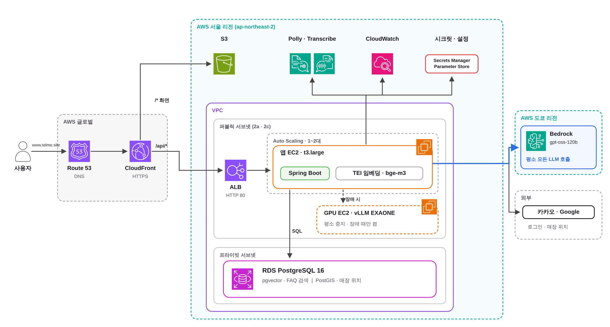</p>

| 구성 | 내용 |
| --- | --- |
| 진입 | CloudFront가 `/api/*`, `/oauth2/*`, `/login/oauth2/*`는 ALB(HTTP 80)로, 나머지는 S3 정적 화면으로 보냄 |
| 앱 | Auto Scaling 그룹 t3.large 1~2대(퍼블릭 서브넷 2a·2c), Spring Boot + TEI 임베딩(bge-m3), 헬스 체크 `/actuator/health` |
| DB | RDS PostgreSQL 16(db.t4g.micro, 프라이빗 서브넷) — pgvector로 FAQ 검색, PostGIS로 매장 위치 |
| LLM | 평소 LLM 호출은 모두 Bedrock gpt-oss-120b(도쿄), 장애 때만 GPU EC2(g6.xlarge)의 vLLM EXAONE 3.5 7.8B |
| 그 밖 | Polly(답변 듣기), Transcribe(음성 질문), CloudWatch, Secrets Manager · Parameter Store, 카카오·Google 로그인과 카카오 지도·길찾기 |

AWS 리소스는 [Terraform](infra/terraform/README.md)으로 관리합니다.

<p align="center">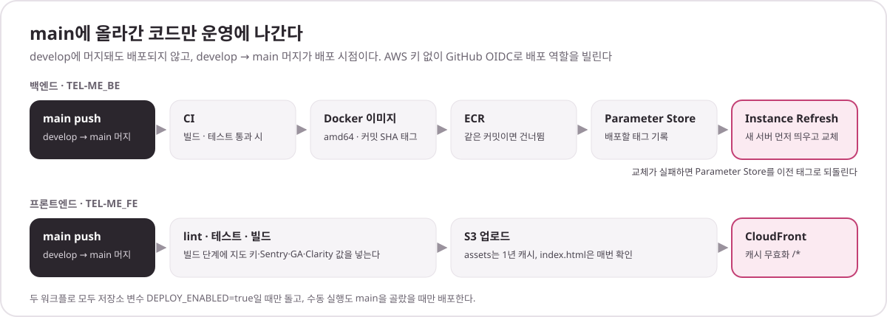</p>

`main`에 push되면 배포됩니다. develop에 머지된 코드는 CI만 돌고 운영에 나가지 않습니다. 백엔드는 CI가 통과하면 GitHub Actions가 OIDC로 AWS에 접속해 이미지를 ECR에 올리고, Parameter Store의 이미지 태그를 바꾼 뒤 ASG Instance Refresh로 새 서버를 먼저 띄우고 교체합니다. 교체가 실패하면 태그를 이전 값으로 되돌립니다. 프론트엔드는 빌드 결과를 S3에 올리고 CloudFront 캐시를 비웁니다.

<br>

## 기술 스택

| 구분 | 사용 기술 |
| --- | --- |
| Language · Framework |     |
| Database |     |
| AI |     -000000?style=flat-square&logo=ollama&logoColor=white) |
| Infra |     |
| Monitoring · Docs |    |
| Collaboration |   |

<details>
<summary>버전과 주요 라이브러리</summary>

| 구분 | 버전 |
| --- | --- |
| Java | 21 |
| Spring Boot | 3.5.16 |
| Gradle | 8.14.5 (Wrapper) |
| PostgreSQL | 16 + pgvector 0.8.2 + PostGIS 3 |
| Ollama (로컬 개발) | 0.34.0 |

주요 라이브러리: Spring Web · Validation · Data JPA(JdbcTemplate) · Security · OAuth2 Client · Flyway · hibernate-vector · Resilience4j 2.4.0 · springdoc-openapi 2.8.17 · Actuator · Sentry 8.61.0 · AWS SDK 2.55.6(Bedrock Runtime, Polly, Transcribe Streaming, EC2) · Lombok

</details>

<br>

## ERD

스키마는 Flyway 마이그레이션(`src/main/resources/db/migration`, V1~V46)으로 관리합니다. 영역별로 나눠 주요 컬럼만 표시했습니다.

<details open>
<summary><b>채팅 · 실행 기록</b></summary>

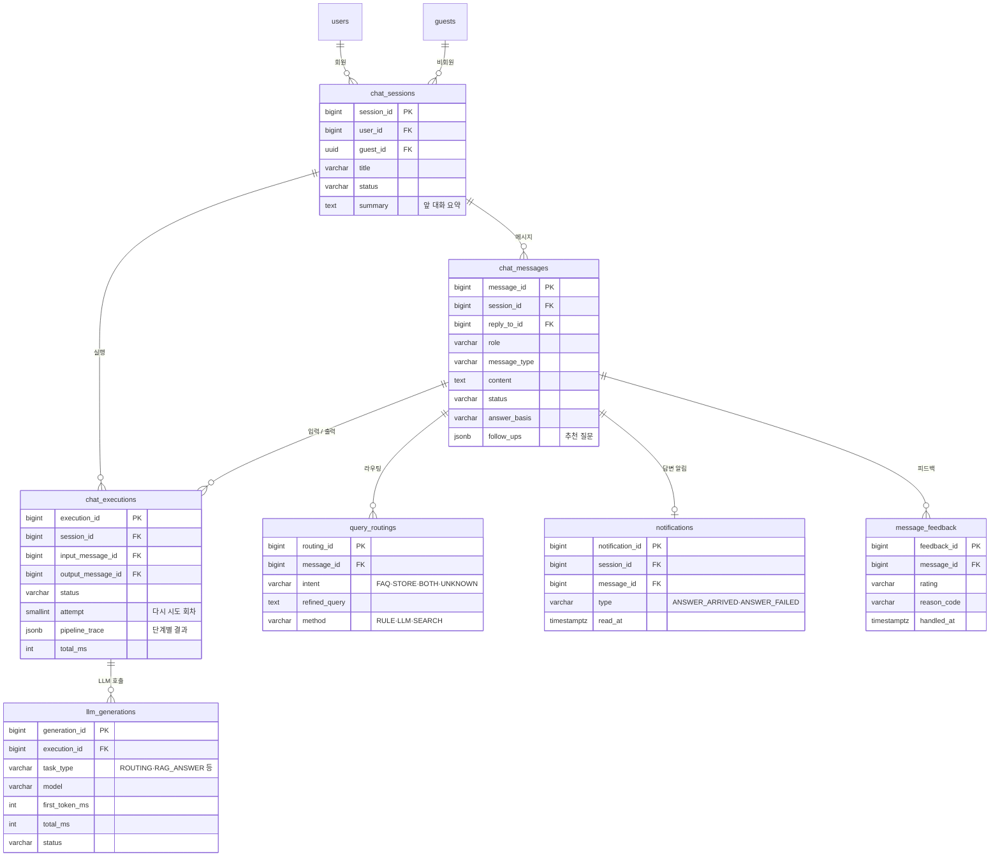

</details>

<details>
<summary><b>FAQ · 근거 · 되묻기</b></summary>

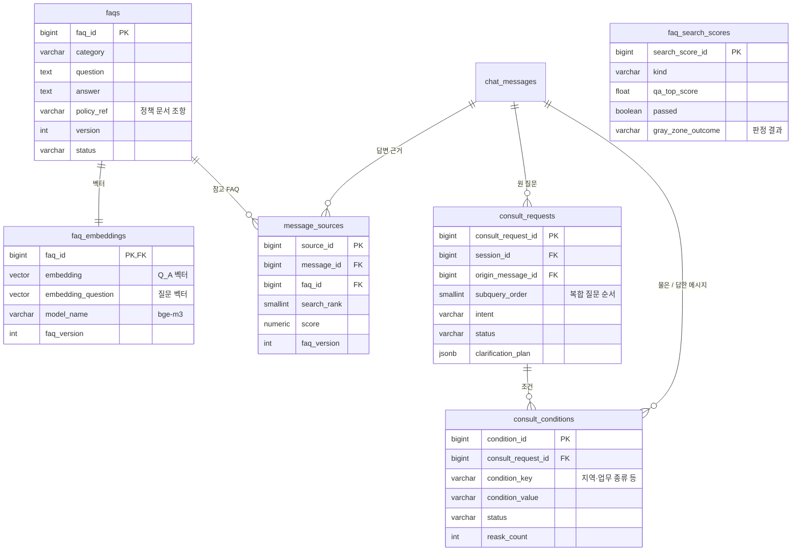

</details>

<details>
<summary><b>회원 · 입력 검사</b></summary>

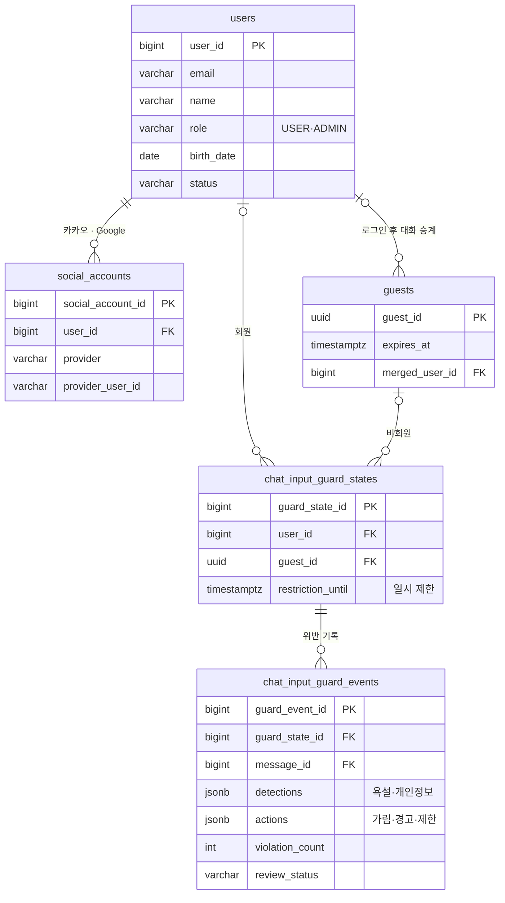

</details>

<details>
<summary><b>요금제 · 매장</b></summary>

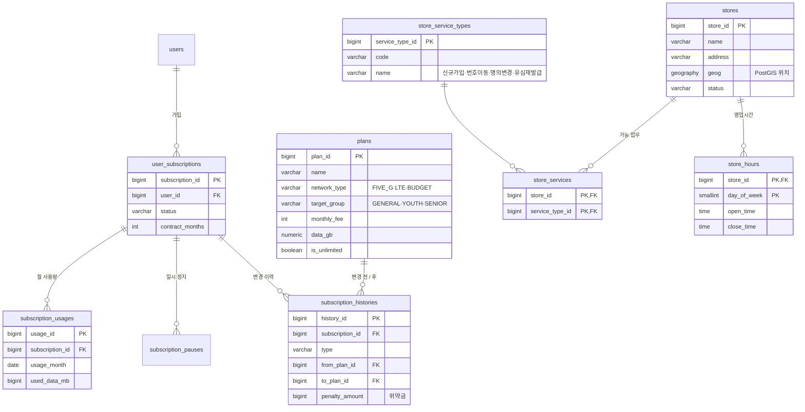

</details>

이 밖에 외부 API 일일 사용량을 세는 `speech_daily_usages`, `store_route_daily_usages`가 있습니다.

<br>

## 관리자 화면

<table>
  <tr>
    <td width="50%"></td>
    <td width="50%">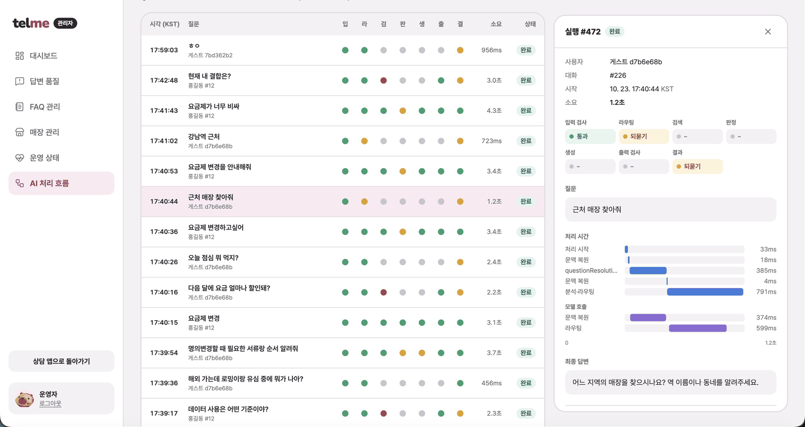</td>
  </tr>
  <tr>
    <td align="center"><b>대시보드</b><br><sub>답 못 한 질문, 오류 신고, 하루 질문 수</sub></td>
    <td align="center"><b>AI 처리 흐름</b><br><sub>실행마다 단계별 결과 · 처리 시간 · 모델 호출</sub></td>
  </tr>
</table>

FAQ 등록·수정·복구, 매장 관리, 피드백·미답변 질문 처리, 검색 점수 통계, LLM 오류·응답 시간 조회를 제공합니다.

<br>

## API 요약

모든 API는 `/api/v1` 아래에 있습니다. 전체 명세는 실행 후 [Swagger UI](http://localhost:8080/swagger-ui/index.html)에서 확인합니다.

<details>
<summary>도메인별 API 펼치기</summary>

| 도메인 | 주요 경로 | 내용 |
| --- | --- | --- |
| 채팅 | `/chat/sessions`, `/chat/sessions/{sessionId}/messages`, `/chat/sessions/{sessionId}/executions/{executionId}/subscribe` | 대화 생성·목록·제목·종료, 질문 전송, SSE 구독, 실행 기록, 다시 시도, 참고 FAQ, 비회원 사용 한도, 입력 제한 상태 |
| 회원 | `/auth/signup`, `/auth/login`, `/auth/logout`, `/auth/me` | 세션 로그인, 카카오·Google 연결, 소셜 신규 가입, 로그인 방법 확인 |
| FAQ | `/faqs`, `/admin/faqs` | 사용자 FAQ 조회, 관리자 등록·수정·상태 변경·영구 삭제 |
| 매장 | `/stores/nearby`, `/stores/region`, `/stores/{storeId}/route`, `/admin/stores` | 현재 위치·지역 검색, 가능 업무, 상세, 길찾기, 관리자 매장 관리 |
| 요금제 | `/plans`, `/subscriptions`, `/usage/me` | 요금제 조회, 가입·해지·일시 정지·변경, 위약금, 사용량 |
| 음성 | `/chat/messages/{messageId}/speech`, `/chat/speech/transcriptions` | 답변 듣기(TTS), 음성 질문(STT) |
| 피드백 | `/chat/messages/{messageId}/feedback`, `/admin/feedbacks` | 답변 평가, 관리자 처리 |
| 알림 | `/chat/notifications` | 목록, 안 읽은 수, 읽음 처리 |
| 관리자 | `/admin/dashboard`, `/admin/monitoring/executions`, `/admin/unanswered`, `/admin/system/*` | 대시보드, AI 처리 흐름, 미답변 질문, 검색 점수·LLM 오류·응답 시간 |
| 검색 · 라우팅 | `/faq/search`, `/intent-routes` | 검색 테스트 API(운영에서는 꺼짐), 의도 라우팅·복합 질의 분해 단독 호출 |

</details>

<br>

## 프로젝트 구조

```text
src/main/java/com/telme
├── chat           채팅 세션·메시지·실행, SSE 전송, 입력 검사(guard), 문맥 해석
├── intent         질문 의도 라우팅
├── faq            FAQ 관리, pgvector 이중 벡터 검색, 임베딩
├── rag            근거 판정, 답변 생성, 답변 검사
├── consult        업무별 처리(FAQ 되묻기, 요금제 질문·추천, 복합 질문)
├── llm            LLM 클라이언트(Bedrock · vLLM · Ollama), 재시도·대체, GPU 자동 기동, 호출 기록
├── store          매장 검색(PostGIS), 카카오 장소·길찾기
├── plan           요금제
├── subscription   가입·변경·일시 정지·해지
├── usage          사용량
├── member         회원, 세션 인증, 소셜 로그인
├── speech         음성 질문(Transcribe)·답변 듣기(Polly)
├── feedback       답변 피드백
├── notification   답변 알림
├── dashboard      관리자 대시보드
└── global         공통 설정, 보안, 예외 처리
```

<br>

## 실행 방법

### 사전 준비

- JDK 21
- Docker Desktop

### 1. 환경변수 파일 만들기

```bash
cp .env.example .env
```

기본값 그대로 실행되므로, 포트가 겹칠 때만 값을 바꾸면 됩니다. `.env`는 커밋하지 않습니다.
`bootRun`이나 STS는 `.env`를 자동으로 읽지 않습니다. DB 접속값을 바꿨다면 `POSTGRES_HOST`, `POSTGRES_PORT`, `POSTGRES_DB`, `POSTGRES_USER`, `POSTGRES_PASSWORD`를 애플리케이션 실행 환경에도 같은 값으로 설정합니다.

### 2. DB 실행

```bash
docker compose up -d
```

PostgreSQL 16 + pgvector가 실행되고, 최초 생성 시 `vector` 확장이 자동으로 켜집니다.
현재 Compose는 PostgreSQL과 선택 실행하는 Ollama만 띄웁니다. 아래 `bootRun`은 호스트에서 백엔드를 실행합니다.

### 3. 애플리케이션 실행

```bash
./gradlew bootRun
```

STS에서는 `File → Import → Gradle → Existing Gradle Project`로 불러온 뒤 `TelmeApplication`을 실행합니다.

| 주소 | 설명 |
| --- | --- |
| http://localhost:8080/actuator/health | 서버 상태 확인 |
| http://localhost:8080/swagger-ui/index.html | API 문서 |

채팅 API는 회원 세션이나 자동 발급된 게스트 세션으로 이용할 수 있습니다. 피드백 기능의 활성화 방법과 요청 형식은 [피드백 API 문서](docs/02-features/feedback/feedback-api.md)를 참고하세요.
욕설 경고·일시 제한, 개인정보 마스킹과 프런트 응답 계약은 [채팅 입력 검사](docs/01-pipeline/01-input-guard/chat-input-guard.md)를 참고하세요.
최종 답변의 욕설 검사·안전 안내와 실패 계약은 [챗봇 출력 검사](docs/01-pipeline/07-answer-validation/chat-output-guard.md)를 참고하세요.

### 4. 종료

```bash
docker compose down      # 컨테이너 종료 (데이터 유지)
docker compose down -v   # 데이터까지 삭제
```

### 빌드 · 테스트

```bash
./gradlew build
```

테스트가 DB에 접속하므로 `docker compose up -d`로 PostgreSQL을 먼저 실행해야 합니다.
develop · main 대상 PR과 push에서는 GitHub Actions가 같은 빌드를 자동으로 실행합니다.

<details>
<summary><b>Ollama (선택)</b></summary>

LLM 기능을 개발하거나 확인할 때만 필요합니다. 두 방식 중 하나를 선택합니다.

**Docker로 실행**

```bash
docker compose --profile ollama up -d
docker exec telme-ollama ollama pull exaone3.5:7.8b
docker exec telme-ollama ollama pull bge-m3
```

**앱으로 설치 (Mac 권장)**

Mac은 Docker 안에서 GPU를 쓰지 못해 응답이 느릴 수 있습니다. 속도가 필요하면 [Ollama 앱](https://ollama.com/download)을 설치하고 모델을 받습니다. 이 경우 Docker의 ollama 서비스는 띄우지 않습니다(포트 11434 충돌).

```bash
ollama pull exaone3.5:7.8b
ollama pull bge-m3
```

두 방식 모두 주소는 `http://localhost:11434`입니다.

</details>

<details>
<summary><b>백엔드 Docker 이미지</b></summary>

`Dockerfile`은 Spring Boot API 이미지만 빌드합니다. 로컬에서 컨테이너로 확인하려면 위 방법으로 `.env` 파일을 만들고 DB를 실행한 뒤 다음 명령을 사용합니다.

```bash
docker build -t telme-be:local .
docker run --rm --env-file .env -e POSTGRES_HOST=host.docker.internal -p 127.0.0.1:8080:8080 telme-be:local
```

컨테이너의 `localhost`는 호스트 PC가 아니므로, Docker Desktop에서는 `host.docker.internal`로 Compose가 호스트에 공개한 DB 포트에 연결합니다. 포트나 DB 계정을 바꿨다면 `.env`의 값을 사용합니다. 종료할 때는 실행 중인 `docker run` 명령에서 `Ctrl+C`를 누릅니다.

EC2 배포에서는 로컬 `.env` 대신 RDS 접속값을 `SPRING_DATASOURCE_URL`, `SPRING_DATASOURCE_USERNAME`, `SPRING_DATASOURCE_PASSWORD` 환경변수로 전달합니다. Docker 이미지 빌드는 테스트를 제외하며, 테스트는 위 Gradle 빌드와 CI에서 실행합니다.

</details>

<details>
<summary><b>대중교통 출발 도보 조회 제한</b></summary>

`GET /api/v1/stores/{storeId}/route/origin-walk`는 출발지에서 선택한 경로의 첫 좌표까지 조회합니다.
다음 환경변수는 외부 API를 호출하기 전에 검사하며, 변경 후 서버를 재시작해야 합니다.
`.env.example`에 예시가 있고 `bootRun`·IDE 실행에서는 실행 환경변수로도 전달해야 합니다.

| 환경변수 | 기본값 | 의미 |
| --- | --- | --- |
| `STORE_ROUTE_ORIGIN_WALK_MAX_STRAIGHT_DISTANCE_METERS` | `3000` | 두 좌표의 직선거리 상한(m). 초과하면 `400 / STORE400-5` |
| `STORE_ROUTE_ORIGIN_WALK_REQUESTS_PER_MINUTE` | `30` | IP별 첫 허용 요청부터 60초 동안 허용할 요청 수. 초과하면 `429 / STORE429-0` |
| `STORE_ROUTE_ORIGIN_WALK_TRUSTED_PROXIES` | 빈 값 | 신뢰할 프록시 IP/CIDR 목록(쉼표 구분). 빈 값이면 `X-Forwarded-For`를 무시 |

거리 상한과 요청 수는 양수만 허용하며, 빈 값이면 기본값을 사용합니다. 초과 요청은 카카오 호출과 일일 예산 차감 전에 차단됩니다.
거리 초과는 분당 횟수도 사용하지 않습니다. 거리 검사를 통과한 시도는 매장 없음·외부 장애 등으로 실패해도 분당 횟수에 포함됩니다.
기존 `STORE_ROUTE_MAX_DISTANCE_METERS`는 실제 경로에 대한 **조회 후** 제한이므로 함께 유지합니다.

프론트에서 서로 다른 경로를 처음 선택하면 요청 수에 포함되고, 같은 경로 재선택은 프론트 캐시를 사용하므로 요청 수가 늘지 않습니다.
기본 30회는 경로 11개를 연속 선택하는 경우를 허용합니다. 같은 공인 IP의 사용자들은 횟수를 공유하므로 시연·운영 트래픽에 맞춰 조정합니다.
분당 제한은 서버별 메모리에 저장되어 재시작 시 초기화되고, 서버가 여러 대면 대수만큼 느슨해집니다. 공용 일일 WALK 예산은 기존 DB 제한을 유지합니다.
활성 IP가 서버당 10,000개에 도달하면 기존 IP의 제한을 유지하고 새 IP 요청을 429로 거절하며, 만료된 항목을 정리한 뒤 다시 받습니다.
이 방어는 요청 좌표가 실제 대중교통 응답에 포함됐는지 증명하지는 않습니다.

배포의 CloudFront→ALB 경로에서는 두 프록시의 실제 대역을 모두 신뢰하도록 설정해야 합니다. 빠지면 프록시 IP로 합산될 수 있습니다.
`infra/terraform/config.tf`는 VPC 대역과 기존 CloudFront origin-facing 관리형 prefix list의 대역을 SSM 환경변수로 전달합니다.
코드 머지만으로 기존 SSM 값이 추가되지는 않으므로 Terraform 반영 후 앱 인스턴스 교체/재시작이 필요합니다.
운영에서는 서로 다른 사용자 요청이 서로 다른 IP로 집계되는지 수동 확인해야 합니다. 모든 IP 대역을 신뢰하도록 설정하지 않습니다.

</details>

<br>

## 문서 모음

설계를 바꿀 때마다 같은 평가셋으로 다시 재고, 그 과정과 결과를 `docs/`에 남겼습니다. 읽는 순서와 분류 기준은 [문서 목차](docs/README.md)에 있습니다.

| 묶음 | 주제 | 문서 |
| --- | --- | --- |
| **[공통&nbsp;기준](docs/00-overview/README.md)** | 정책·분류 | [faq-taxonomy](docs/00-overview/faq-taxonomy.md) · [policy](docs/00-overview/policy.md) |
| **[채팅&nbsp;파이프라인](docs/01-pipeline/README.md)** | 복합&nbsp;상담 | [compound-comparison-quality](docs/01-pipeline/compound-comparison-quality.md) · [compound-faq-store](docs/01-pipeline/compound-faq-store.md) |
|  | 입력&nbsp;검사 | [chat-input-guard-status](docs/01-pipeline/01-input-guard/chat-input-guard-status.md) · [chat-input-guard](docs/01-pipeline/01-input-guard/chat-input-guard.md) |
|  | 문맥&nbsp;·&nbsp;라우팅 | [basic-conversation](docs/01-pipeline/02-context-routing/basic-conversation.md) · [context-resolution](docs/01-pipeline/02-context-routing/context-resolution.md) · [multiturn-context-and-summary](docs/01-pipeline/02-context-routing/multiturn-context-and-summary.md) · [routing-call-comparison](docs/01-pipeline/02-context-routing/routing-call-comparison.md) · [routing-evaluation](docs/01-pipeline/02-context-routing/routing-evaluation.md) · [routing-spacing-and-requests](docs/01-pipeline/02-context-routing/routing-spacing-and-requests.md) |
|  | FAQ&nbsp;검색 | [boundary-experiment-20261001](docs/01-pipeline/03-retrieval/boundary-experiment-20261001.md) · [dual-vector-vs-reranker](docs/01-pipeline/03-retrieval/dual-vector-vs-reranker.md) · [eval-set-supplement](docs/01-pipeline/03-retrieval/eval-set-supplement.md) · [multigold-label-additions](docs/01-pipeline/03-retrieval/multigold-label-additions.md) · [rerank-multigold-experiment](docs/01-pipeline/03-retrieval/rerank-multigold-experiment.md) · [search-failure-analysis](docs/01-pipeline/03-retrieval/search-failure-analysis.md) · [search-quality-calibration](docs/01-pipeline/03-retrieval/search-quality-calibration.md) · [search-threshold-060-and-answer-quality](docs/01-pipeline/03-retrieval/search-threshold-060-and-answer-quality.md) · [search-tuning](docs/01-pipeline/03-retrieval/search-tuning.md) · [single-faq-search](docs/01-pipeline/03-retrieval/single-faq-search.md) · [topk-latency](docs/01-pipeline/03-retrieval/topk-latency.md) |
|  | 근거&nbsp;판정 | [evidence-resolver-comparison](docs/01-pipeline/04-evidence-judgment/evidence-resolver-comparison.md) · [gray-zone-upper-band](docs/01-pipeline/04-evidence-judgment/gray-zone-upper-band.md) · [judge-serving-comparison](docs/01-pipeline/04-evidence-judgment/judge-serving-comparison.md) |
|  | 되묻기 | [clarification-extraction-model](docs/01-pipeline/05-clarification/clarification-extraction-model.md) · [condition-extraction](docs/01-pipeline/05-clarification/condition-extraction.md) |
|  | 답변&nbsp;생성 | [answer-generation-comparison](docs/01-pipeline/06-answer-generation/answer-generation-comparison.md) · [answer-generation-exaone-repeat](docs/01-pipeline/06-answer-generation/answer-generation-exaone-repeat.md) · [answer-quality](docs/01-pipeline/06-answer-generation/answer-quality.md) · [followup-recommendation](docs/01-pipeline/06-answer-generation/followup-recommendation.md) · [rag-answer-prompt-experiments](docs/01-pipeline/06-answer-generation/rag-answer-prompt-experiments.md) |
|  | 답변&nbsp;검사 | [answer-guard-recovery](docs/01-pipeline/07-answer-validation/answer-guard-recovery.md) · [chat-output-guard](docs/01-pipeline/07-answer-validation/chat-output-guard.md) |
|  | 저장&nbsp;·&nbsp;전달 | [rag-answer-delivery](docs/01-pipeline/08-delivery/rag-answer-delivery.md) · [rag-answer-persistence-verification](docs/01-pipeline/08-delivery/rag-answer-persistence-verification.md) |
| **[독립&nbsp;기능](docs/02-features/README.md)** | 매장 | [chat-store-search-contract](docs/02-features/store/chat-store-search-contract.md) · [store-nearest-search](docs/02-features/store/store-nearest-search.md) · [store-search-operations](docs/02-features/store/store-search-operations.md) |
|  | 요금제 | [plan-conditions-model](docs/02-features/plan/plan-conditions-model.md) · [plan-question-model](docs/02-features/plan/plan-question-model.md) |
|  | 피드백 | [feedback-api](docs/02-features/feedback/feedback-api.md) |
| **[품질&nbsp;평가](docs/03-evaluation/README.md)** | LLM&nbsp;Judge | [chat-judge](docs/03-evaluation/chat-judge/README.md) · [chat-pipeline-quality-criteria](docs/03-evaluation/chat-judge/chat-pipeline-quality-criteria.md) · [judge-validation-v1-review-form](docs/03-evaluation/chat-judge/judge-validation-v1-review-form.md) · [label-review](docs/03-evaluation/chat-judge/label-review.md) · [service-evaluation](docs/03-evaluation/chat-judge/service-evaluation.md) |
|  | 모델&nbsp;비교 | [bedrock-switch-evaluation](docs/03-evaluation/model-comparison/bedrock-switch-evaluation.md) · [chat-live-answer-fixes](docs/03-evaluation/model-comparison/chat-live-answer-fixes.md) · [exaone-repeat-evaluation](docs/03-evaluation/model-comparison/exaone-repeat-evaluation.md) |
| **[운영](docs/04-operations/README.md)** | 검증·서빙·인프라 | [chat-execution-trace-verification](docs/04-operations/chat-execution-trace-verification.md) · [chat-failure-fallback-verification](docs/04-operations/chat-failure-fallback-verification.md) · [flyway](docs/04-operations/flyway.md) · [gpt-oss-switch](docs/04-operations/gpt-oss-switch.md) · [serving-comparison](docs/04-operations/serving-comparison.md) · [terraform](infra/terraform/README.md) |

<br>

## 팀 · 일정

| 이름 | 담당 영역 | 주도한 작업 |
| --- | --- | --- |
| 구지민 (팀장) | 데이터/검색 기반, 배포 인프라 | 정책 문서, FAQ 분류 설계, FAQ 1,150건 생성·검증·적재, 검색 평가셋, 이중 벡터 도입, 관리자 AI 처리 흐름 모니터링, Terraform 인프라, GPU 자동 기동 |
| 박서희 | 답변 검증·안전성 | 답변 근거 검증·실행 추적, 욕설 검사·개인정보 가림, 반복 위반 제한, 피드백 API |
| 박신형 | FAQ 검색·근거 품질·프론트엔드 | FAQ 벡터 검색 구축, 검색 품질 개선, 후속 질문 추천, 회원 인증, 프론트엔드 개발 |
| 박찬영 | 답변 평가·관리자 운영 | 답변 평가(피드백), 관리자 매장 관리, 운영 모니터링·대시보드, 사용자 FAQ 조회 |
| 변우림 | 라우팅·매장 검색·음성 | 질문 의도 라우팅, 지역·장소·현재 위치 매장 검색, 음성 질문·답변 듣기, 채팅 요금제 안내, Sentry 오류 수집 |
| 이용재 | AI 채팅 파이프라인 | 채팅 API, 질문 이해(문맥·라우팅·복합 질문), 모델 전환·서빙 결정, 답변 품질 평가 |
| 최정현 | 위치·지도·실시간 답변 | PostGIS 최근접 매장 검색, 매장 API, 카카오 로컬·길찾기, 챗봇 GPS, SSE 실시간 답변 |
| 함세연 | 답변 생성·관리자 모니터링 | LLM/RAG 답변 생성, 되묻기 흐름, 관리자 AI 모니터링, 요금제 API, 답변 품질 개선 |

**2026.09.09 ~ 10.27 (7주)**

| 사전 기획 | 스프린트 1 | 스프린트 2 | 스프린트 3 | 배포 · 베타 | 마무리 |
| :---: | :---: | :---: | :---: | :---: | :---: |
| 9/9 ~ 9/15 | 9/16 ~ 9/27 | 9/28 ~ 10/11 | 10/12 ~ 10/18 | 10/19 ~ 10/24 | 10/25 ~ 10/27 |
