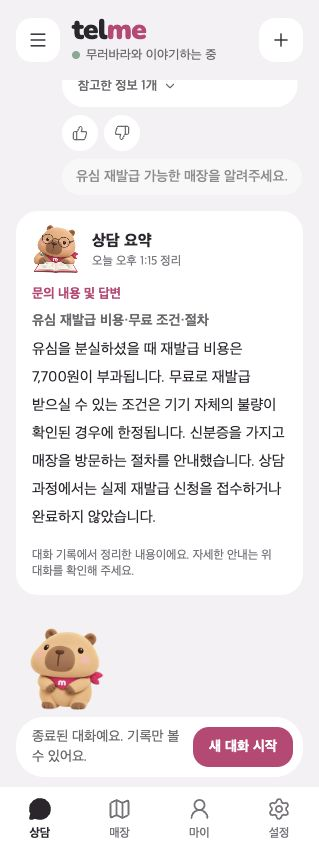
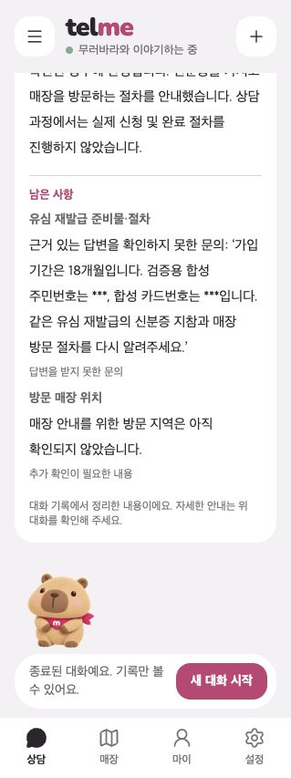

# 상담 종료 요약 비교와 방문 절차 보존

**답변 원문을 유지하면서 같은 문의끼리 묶는 방식을 적용 후보로 정했다.**
AI가 안내를 다시 쓰면 조건과 처리 상태가 달라지는 사례가 있어, 안내는 원문 중심으로 묶고 남은 사항은 저장된 상담 상태에서 구성한다.
2026-10-15 최신 백엔드 `aea06404`, 프론트 `4a2980a0`에 로컬 변경을 적용해 실제 채팅부터 종료 요약까지 재검증했다. 아직 게시 전이다.

## 방식 비교

| 방식 | 정리 방법 | 기존 비교에서 확인한 차이 |
| --- | --- | --- |
| 원문 발췌 | AI가 안내 번호를 선택하고 서버가 답변 원문을 조립 | 재작성에 따른 의미 변경을 줄이지만, 원래 답변의 오류·누락은 그대로 남음 |
| 상담 정리형 보완판 | 선택한 안내를 AI가 짧게 재작성하고 보존 검사 | 자연스럽지만 검사 후에도 조건·처리 상태가 바뀐 사례가 남음 |
| 기존 자유문장형 | 대화 전체를 AI가 자유롭게 압축 | 중요한 조건 누락과 새로운 설명 추가 사례가 있음 |
| 개선 자유문장형 | 정정·대상·조건 보존 규칙을 추가해 재작성 | 기존보다 개선됐지만 의미 변경을 모두 막지는 못함 |
| 원본 발언 선택형 | AI가 메시지 번호를 선택하고 원본 메시지를 보존 | 의미 변경은 적지만 내부 메시지 표식과 끊기는 문맥이 고객용으로 어색함 |
| 문의별 재작성 v5·v6 | 문의를 묶고 AI가 문단을 재작성, 검사 실패 시 원문 복귀 | v6도 추가 반례에서 방문자 조건 누락·허위 처리 대기가 통과함 |
| **문의별 원문 중심 + 발췌 v13** | **서버가 같은 문의의 안내를 묶고, 실제 질문에 맞는 제목과 남은 상태를 구성** | **추가 안내 재작성 없이 배치를 개선. 원문 오류와 문의 연결 규칙의 한계는 별도 검증 필요** |

기존 CORE 6개·이어 묻기·추가 반례 결과는 그대로 보존했다. 위 표는 기존 실험의 관찰이며, 이번에 모든 버전을 새로 실행했다는 뜻이 아니다.
v13, v5·v6, 원문 중심 v1은 서로 다른 계열의 버전 번호다. 숫자가 크다고 다른 계열보다 우수하다는 의미는 아니다.

## 신분증·매장 방문이 다시 빠진 원인과 수정

- 이전 보완은 `summary-live-ui-20261014-v2` 로컬 실험에만 있었고 최신 `develop`의 `AnswerGuard`에는 없었다. 병합된 보완이 다시 깨진 것으로 확인된 것은 아니다.
- 기존 검사는 근거 없는 ‘이벤트 페이지’와 정상 방문 절차가 한 문장에 섞이면 문장 전체를 삭제했다. 요약은 저장된 답변을 쓰므로 이미 사라진 절차를 복원할 수 없었다.
- 이제 신분증·방문·같은 방문 창구가 확인되는 **유일한 근거 문장**이 있으면 그 문장을 그대로 사용한다. 대리인 준비물·방문 불가 조건도 함께 보존한다.
- 근거가 여러 개이거나 방문 창구가 다르면 임의로 고르지 않는다. 금액·기간 등 기존 검사도 계속 적용한다.

| 실제 유심 상담 단계 | 수정 후 결과 |
| --- | --- |
| 모델 원출력 | 두 상담에서 근거 없는 ‘LG샵 이벤트 이벤트 페이지 또는 지정된 매장’ 생성 |
| 답변 검사·채팅 저장·화면 | 잘못된 창구 제거, ‘신분증을 가지고 매장을 방문하는 절차를 안내했습니다’ 보존 |
| 종료 요약 | 7,700원·기기 불량 시 무료 조건·신분증·매장 방문·신청 미처리 상태 보존 |
| 재조회 | 두 상담 모두 새로고침 후 요약 동일, 저장된 본문과 화면 일치 |

## 이번 검증 결과

| 구분 | 범위와 결과 |
| --- | --- |
| 자동 테스트 완료 | 백엔드 관련 290개 통과. 모델 대역 사용. 방문 절차 회귀 11개는 수정 전 4개 실패 → 수정 후 모두 통과 |
| 프론트 자동 검증 | 요약 카드 8개 통과, 타입 검사 포함 빌드 통과 |
| 실제 로컬 모델 검증 완료 | 실제 UI 상담 2개·사용자 입력 4회. EXAONE 3.5 7.8B / bge-m3, 합성 FAQ 2개·별도 로컬 DB 사용. 대역 응답·유료 모델·외부 판정기 미사용 |
| 화면 검증 완료 | 채팅 → 종료 → 요약 조회 → 새로고침. 한 카드 안에 문의별 안내와 남은 사항 표시. 기본 유심 상담은 남은 사항 영역 숨김 |
| 누락·환각 검증 | 두 유심 안내에서 비용·무료 조건·신분증·방문·미처리 상태 보존. 최종 안내에 잘못된 창구 미발견. 근거 없는 접수·처리 대기 생성 미발견 |
| 개인정보 검증 | 실제 모델 입력·원출력·저장 기록·최종 화면 72단계 검사. 지원 민감번호·합성 원번호·구분 가능한 끝자리 노출 0건. 양성 대조 번호 2개 검출 |
| 기존 결과 보존 | 기존 결과·문서·사진 492개 해시 비교에서 변경 0개 |

실제 모델 채팅 호출은 라우팅·제목·요약 등을 포함해 17회이며, 임베딩 호출 5회에는 FAQ 적재도 포함된다.
개인정보 검사는 프로젝트 `ChatInputInspector`의 지원 번호 유형과 합성 번호 대조 범위다. 이 결과는 모든 개인정보 유형의 안전성이나 전체 환각률 0%를 뜻하지 않는다.
[검증 기준과 집계](../scripts/data/consultation-summary-comparison/results-summary.json)에 실행 범위를 분리했다.

## 화면과 적용 범위

- 백엔드: 문의 묶음·제목·기간·상태·마스킹 구성. AI는 안내 번호를 선택하며 안내를 다시 쓰는 추가 모델 호출은 없다.
- 응답 계약: 기존 `topics/guidance/pendingItems` 유지, `inquiries[{title,text}]`, `remaining[{title,text,kind}]` 추가. 테이블 스키마 변경 없음.
- 프론트: 카드 하나 안에 ‘문의 내용 및 답변’과 ‘남은 사항’을 구분한다. 같은 문의는 한 문단, 다른 문의는 별도 문단, 남은 사항이 없으면 숨긴다. 이번 화면 변경은 별도 로컬 검증 복사본이며 담당자와 응답 계약을 맞춰야 한다.

## 남은 확인

- 개인정보·가입 기간을 포함한 긴 이어 묻기는 검색에서 답을 찾지 못했다. 요약은 이를 ‘답변을 받지 못한 문의’로 남겼다. 매장 지역 미확인은 별도 사유로 구분했다. 검색 문제를 해결한 결과는 아니다.
- 남은 사항에 원질문을 인용하므로 문장이 길 수 있다. 규칙 기반 문의 연결, 원답변 자체의 오류·누락, 안내 8개 초과 한도도 남는다.
- 실제 운영 FAQ, 교체 예정 생성·판정 모델, 원격 CI, 독립 사람 검수는 미검증이다. 이번 실제 채팅 2개 결과를 과거 6개 전체 재검증으로 해석하지 않는다.
- 관련 변경은 `feat/TELME-170-consultation-summary`의 미커밋 상태다. 커밋·푸시·PR 등록·공유 DB 변경은 하지 않았다.
