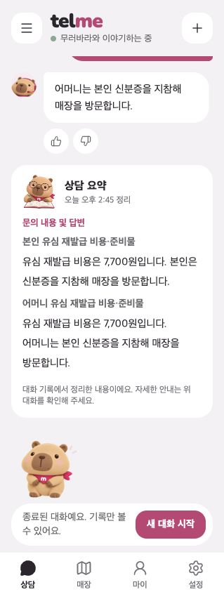
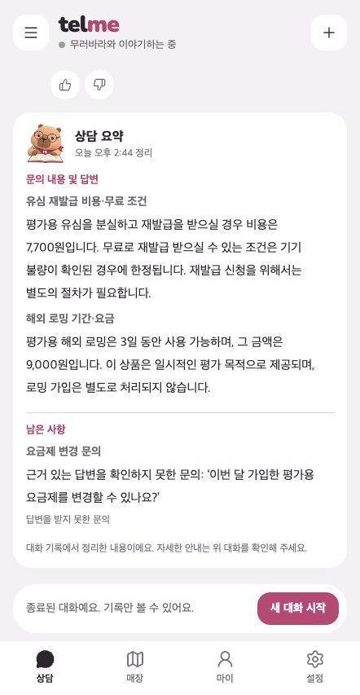
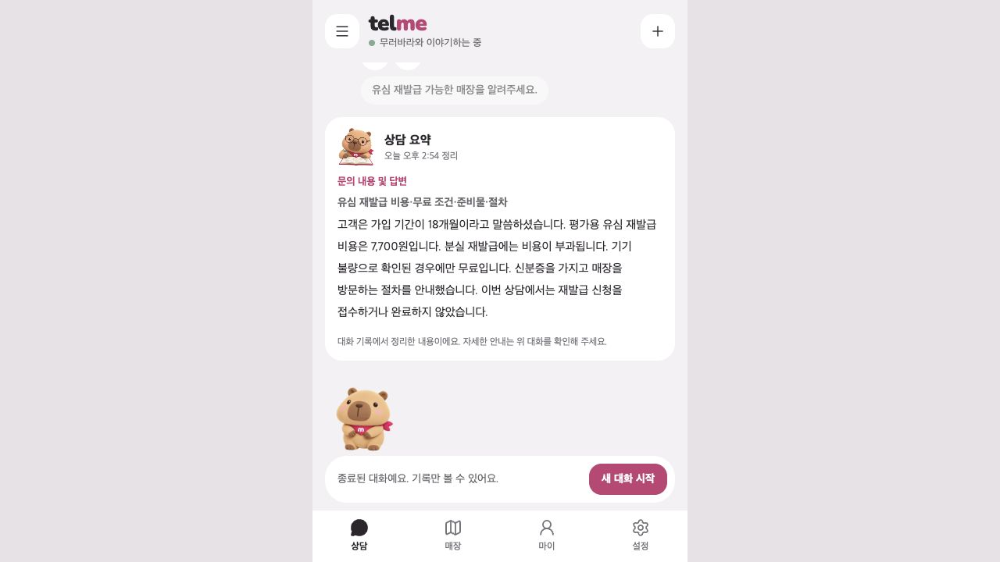

# 상담 요약의 대상 구분·누락 재검증

기존 6개 상담에 이어묻기·미해결 상태·다른 사람과 회선이 섞인 반례를 더해 **26개 상담을 실제 로컬 모델로 재검증**했다. 같은 문의의 답변 원문을 묶는 방향은 유지하되, 동일 문구 때문에 다른 대상의 안내가 빠지는 문제와 기간 주체 변경, 회선 호칭에 따른 잘못된 연결을 보완했다.

## 발견한 문제와 보완

| 문제 | 보완 전 확인 | 보완 후 |
| --- | --- | --- |
| 다른 대상에게 같은 답변을 한 경우 | 어머니·두 번째 회선의 비용이 첫 대상 문단에만 남음. 모델 재생에서 재현 | 같은 문구라도 사람·회선별 출처로 다시 나누어 각 문단에 보존 |
| 가족의 가입 기간 | 아버지 24개월을 “고객은 가입 기간이 24개월”로 변경. 모델 재생에서 재현 | 주체를 확정할 수 없는 기간 문장은 원문을 인용 |
| A회선과 회선 A, 순번과 숫자 표현 | 다른 회선을 사이에 두면 준비물이 최근 회선에 붙음. 자동 반례에서 재현 | 명시한 회선 표기를 통일하고 해당 회선에만 연결. 최종 모델·화면에서 확인 |

동일 문장은 **같은 문의 안에서만** 중복을 제거한다. 다른 사람·회선의 안내를 같은 문구라는 이유로 삭제하지 않는다.

## 검증 결과

| 범위 | 상담 수 | 사실 보존 | 추가 확인 |
| --- | ---: | ---: | --- |
| 기존 CORE 상담 | 6 | 16 / 16 | 비용·무료 조건·방문 절차·정정·기간·남은 문의 유지 |
| 기존 이어묻기 | 8 | 27 / 27 | 같은 문의 연결, 다른 사람·상품·회선 분리 |
| 미해결 상태 반례 | 4 | 사실 점수와 별도 검사 | 지역·방문자 구분·미답변·실행 중단 5개 상태 유지 |
| 혼합·회선 표기 반례 | 8 | 26 / 26 | 같은 답변의 대상별 보존, 주체 변경과 잘못된 연결 미발견 |
| 합계 | **26** | **69 / 69** | 고정 정답 기준에서 누락·대상 혼합·추가 사실 왜곡 미발견 |

- **자동 테스트 완료:** 777개 통과. 모델 대역과 화면용 DB에서 분리한 테스트 DB 사용.
- **실제 로컬 모델 검증 완료:** `exaone3.5:7.8b`, 고정 상담 26개. 모델은 안내 번호를 선택하고 서버가 원문·출처·대상 구분을 구성하며, 요약 문장 재작성 호출은 없다.
- **화면 검증 완료:** 고정 기록 14개를 새 로컬 상담에 재생한 뒤 실제 종료 API·요약 카드를 확인했다. 화면 문구·저장 결과·출처가 최종 모델 결과와 일치한다. 이 14건의 질문과 답변을 모두 새로 생성한 테스트는 아니다.
- **실제 채팅 검증 완료:** 최신 빌드에서 유심 상담 1건을 2회 질의했다. 긴 이어묻기 문맥 복원, 민감번호 마스킹, 답변, 종료 요약, 새로고침 유지까지 확인했다. 두 답변은 검증된 FAQ 원문 전달 경로다.

## 개인정보와 환각 결과

| 구분 | 결과 |
| --- | --- |
| 누락·왜곡 | 최종 69개 기준 보존. 금액뿐 아니라 어느 사람·회선의 안내인지와 출처도 대조 |
| 개인정보 | 최종 185단계의 입력·모델 원출력·저장·화면에서 지원 민감번호·합성 원번호·구분 가능한 끝자리 노출 0건. 양성 대조 번호 2개 검출 |
| 실제 유심 채팅 | 18개월·7,700원·기기 불량 시에만 무료·신분증·매장 방문·미접수 상태가 한 문단에 보존. 같은 문장 중복과 새 신청 권유 없음. 남은 사항이 없어 숨김 |

전체 보완 전후 545단계 검사도 노출 0건이다. 이는 주민번호·카드번호 중심의 합성 자료 검사이며 이름·주소를 포함한 모든 개인정보 보호나 전체 환각률 0%를 입증하는 결과는 아니다. 원답변 자체가 틀리면 원문 중심 요약에도 남을 수 있다. 가족 기간은 인용문으로 남겨 표현이 길어질 수 있다.

## 실제 화면

같은 비용을 안내받아도 본인과 어머니의 문단에 각각 남긴다.

유심·로밍 안내와 답변받지 못한 요금제 문의를 카드 안에서 나눈다.

최신 빌드에서 직접 채팅한 유심 상담은 반복 안내를 한 문단으로 묶는다.

## 화면 목록

| 상담 | 확인 내용 | 종료 요약 |
| --- | --- | --- |
| CORE-01 | 실제 저장된 유심 상담의 동일 기록 비교 | [화면](assets/consultation-summary-mixed-inquiry/CORE-01-summary.jpg) |
| CORE-02 | 가입월 정정과 최신 불가 안내 | [화면](assets/consultation-summary-mixed-inquiry/CORE-02-summary.jpg) |
| CORE-03 | 본인·가족의 기간과 금액 분리 | [화면](assets/consultation-summary-mixed-inquiry/CORE-03-summary.jpg) |
| CORE-04 | 완료 문의와 지역 미확인 문의 | [화면](assets/consultation-summary-mixed-inquiry/CORE-04-summary.jpg) |
| CORE-05 | 민감번호 보호와 정상 기간·금액 보존 | [화면](assets/consultation-summary-mixed-inquiry/CORE-05-summary.jpg) |
| CORE-06 | 긴 상담의 분할·병합과 조건 보존 | [화면](assets/consultation-summary-mixed-inquiry/CORE-06-summary.jpg) |
| MIX-01 | 다른 사람에게 동일 답변을 안내한 뒤 각각 이어묻기 | [화면](assets/consultation-summary-mixed-inquiry/MIX-01-summary.jpg) |
| MIX-02 | 다른 회선에 동일 비용·다른 준비물 | [화면](assets/consultation-summary-mixed-inquiry/MIX-02-summary.jpg) |
| MIX-03 | 요금제와 유심을 오간 뒤 사람을 명시해 재질문 | [화면](assets/consultation-summary-mixed-inquiry/MIX-03-summary.jpg) |
| MIX-04 | 서로 다른 사람·회선 사이의 모호한 참조 | [화면](assets/consultation-summary-mixed-inquiry/MIX-04-summary.jpg) |
| MIX-05 | 아버지와 본인 가입 기간을 분리 | [화면](assets/consultation-summary-mixed-inquiry/MIX-05-summary.jpg) |
| MIX-06 | A회선 호칭을 바꿔 같은 회선을 재질문 | [화면](assets/consultation-summary-mixed-inquiry/MIX-06-summary.jpg) |
| MIX-07 | 다른 회선을 사이에 둔 A회선·회선 A 재지칭 | [화면](assets/consultation-summary-mixed-inquiry/MIX-07-summary.jpg) |
| MIX-08 | 다른 회선을 사이에 둔 첫 번째 회선·회선 1 재지칭 | [화면](assets/consultation-summary-mixed-inquiry/MIX-08-summary.jpg) |

## 코드·공유 범위

- 백엔드의 문의별 출처 분리·기간 문구·회선 연결만 보완했다. 기존 후보 응답의 `inquiries`·`remaining` 구조를 유지한다. 이번 보완으로 추가한 응답 필드·DB 스키마 변경은 없다. `develop` 대비 기존 후보의 DTO 추가는 구현 PR에서 인터페이스 변경으로 명시해야 한다.
- 문의별 표시를 지원하던 기존 로컬 프론트 복사본을 그대로 실행했다. 이번 작업에서 프론트 소스 수정은 없으며 배포 프론트에 구현이 끝났다는 의미는 아니다.
- 최종 기준은 `origin/develop`의 `0730a0d0`, 실행 파일은 `03666aec6dc8`로 시작하는 SHA의 불변 복사본이다. 중간 화면 서버와 최종 코드의 차이는 별도 기록했고, 14개 화면의 응답 내용·출처는 최종 결과와 다시 대조했다.
- 기존 결과·문서·사진 등 6,227개 파일과 기존 상담 1~7은 동일하다. 실행 중 로그 2개 변경은 보존 점검표에 따로 남겼다. 보완 전·중간·최종 결과를 각각 보존했다.
- 운영 FAQ 전체·교체 예정 모델·원격 CI·독립 사람 검수는 미검증이다. 커밋·푸시·PR 등록은 하지 않았다.
- [검증 집계](../scripts/data/consultation-summary-mixed-inquiry/results-summary.json)
